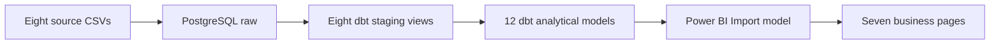
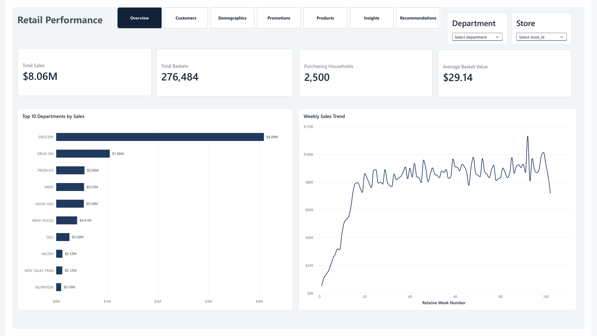

# Retail Performance Analytics

[Live portfolio site](https://siddharthaananthula.github.io/retail-performance-analytics/)

[](https://github.com/siddharthaananthula/retail-performance-analytics/actions/workflows/dbt-quality.yml)

A supermarket analytics portfolio project using PostgreSQL, dbt and Power BI Desktop. It models sales lines, baskets, coupon redemptions and promotions at their proper grains so reporting does not multiply revenue when a product has several coupon or promotion records.

| Validated result from the local dataset | Value |
|---|---:|
| Transaction lines | 2,595,732 |
| Recorded sales | $8,057,463.08 |
| Baskets | 276,484 |
| Purchasing households | 2,500 |
| dbt models / passing tests | 20 / 73 |
| Loader and fixture-safety unit tests | 27 passed |

Private-label products contributed **27.77%** of sales. Baskets containing both National and Private products contributed **80.28%** of sales, but their larger size does not prove that brand mixing caused higher spend. **78.3%** of transaction lines have no matching product-store-week promotion record; their exposure status is unknown, not confirmed negative. [Business findings](docs/business_insights.md) explains the calculations and caveats.



The sales reporting table stays at transaction-line grain. A separate basket fact supports shopping-frequency measures; coupon and campaign bridges describe eligibility or targeting, while the redemption fact records actual use. Power BI relationships run from dimensions to facts in one direction. [Architecture](docs/architecture.md) details grains and relationships.

## Power BI dashboard

The local Power BI Desktop report has seven business pages covering sales performance, customers, demographics, coupons and promotions, products and manufacturers, business insights and recommendations. It includes interactive slicers, dynamic Top N rankings, page navigation and report-page tooltips for department and manufacturer performance.



**Explore the dashboard pages:** [Overview](screenshots/01-overview.png) · [Customers](screenshots/02-customers.png) · [Demographics](screenshots/03-demographics.png) · [Promotions](screenshots/04-promotions.png) · [Products](screenshots/05-products.png) · [Insights](screenshots/06-insights.png) · [Recommendations](screenshots/07-recommendations.png).

These screenshots are static previews of the report, not a publicly hosted interactive dashboard. The data-bearing PBIX is withheld from publication pending review of embedded data and connection settings. Original source CSV files are also excluded. See the [Power BI folder](powerbi/README.md), [dashboard guide](docs/dashboard_guide.md) and [published screenshots](screenshots/). Manufacturer IDs are not verified supplier names.

## Reproduce locally

Download dunnhumby's [The Complete Journey](https://www.dunnhumby.com/source-files/) dataset yourself and put the eight CSVs listed in [data source and reproduction](docs/data_source.md) under `data/raw/`. Those files and the data-bearing PBIX are excluded from this publication snapshot. Dataset download does not establish redistribution permission.

The commands below use PowerShell and assume Python 3.11, Docker Desktop and Power BI Desktop. Run them from the repository root against a **fresh local database**. Choose a local password and put an unquoted `POSTGRES_PASSWORD=your-password` line in an ignored root `.env` file. Never commit that file or paste the password into shared commands.

```powershell
python -m venv .venv
.\.venv\Scripts\Activate.ps1
python -m pip install -r requirements-pipeline.txt
python scripts/ingest.py --data-dir data/raw --preflight-only

docker compose up -d postgres
$env:POSTGRES_PASSWORD = ((Get-Content .env | Where-Object { $_ -match '^POSTGRES_PASSWORD=' } | Select-Object -First 1) -replace '^POSTGRES_PASSWORD=', '')
python scripts/ingest.py --data-dir data/raw

dbt debug --project-dir dbt --profiles-dir dbt
dbt build --project-dir dbt --profiles-dir dbt
```

The loader creates the eight `raw` tables on an empty database and refuses to replace populated tables unless `--replace-existing` is explicitly supplied. Do not use that option when preserving existing data. Compose reads `.env`; the loader and dbt read the shell's `POSTGRES_PASSWORD`. The included dbt profile builds to `analytics`; the previously validated full-data local environment used a separate `dbt_dev` profile. A fresh load and dbt build of the **original full dataset** have not been independently validated end to end. The loader's fresh-load, replacement, rollback and identity safeguards were tested with invented synthetic CSVs; that fixture build passed 20 models and 73 tests. The [GitHub Actions synthetic validation workflow](.github/workflows/dbt-quality.yml) also passed on the initial clean-repository commit (`44c2c1f`). This does not establish production deployment or a new full-dataset rebuild. [Fixture instructions](tests/integration/README.md) explain the isolated tests.

In Power BI Desktop, choose **Get data > PostgreSQL database**, server `127.0.0.1:5432`, database `retail_analytics`, and **Import**. Authenticate as `retail_user` using the local password, then select reporting tables from `analytics` after the build above. Import `fct_sales_promotion` for line-level sales and `fct_baskets` for basket measures; do not sum their sales columns together. [Architecture](docs/architecture.md) lists the recommended relationships.

## Limits and evidence

The full-data local dbt run on **2 November 2026** passed 73 tests and reconciled sales, baskets, households and 2,318 coupon redemptions. Only 801 purchasing households have demographics. Promotion records are missing for most lines, some source promotion states conflict, and promotion-code meanings are unverified. Days are relative, with no verified calendar dates; store IDs have no verified locations. No promotion uplift, margin improvement, production deployment or Snowflake integration is claimed. See [data quality](docs/data_quality.md) and the [decision log](DECISIONS.md).
